# EXCON 수출상담회 시스템 사용 매뉴얼

마지막 갱신: 2026-05-21

## 개요
EXCON은 수출상담회 운영을 위한 관리자·통역사 통합 웹 시스템입니다. 본 매뉴얼은 배포된 사이트의 사용법을 안내하며, 화면 구성과 기본 흐름을 캡처와 함께 설명합니다.

> **매뉴얼 갱신 규칙**: 화면 구성·기능이 바뀔 때 본 문서와 `manual-screenshots/` 폴더를 함께 갱신합니다. 코드 변경 시 매뉴얼이 같이 업데이트되도록 작업 흐름에 포함되어 있습니다.

---

## 1. 로그인

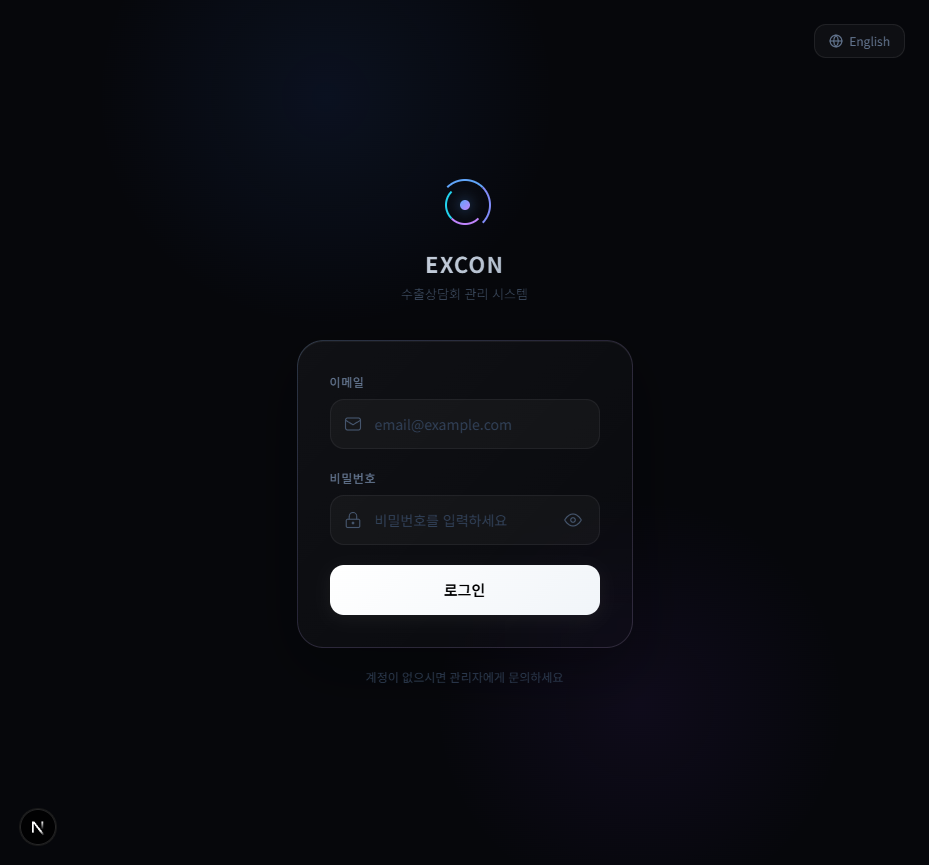

- 좌측 상단에서 한국어 / English 전환 가능
- 이메일 + 비밀번호 입력 → 로그인 버튼
- 관리자는 `/admin`, 통역사는 `/interpreter`로 자동 이동
- 계정이 없으면 관리자에게 문의

---

## 2. 관리자 화면

### 2.1 전체 대시보드

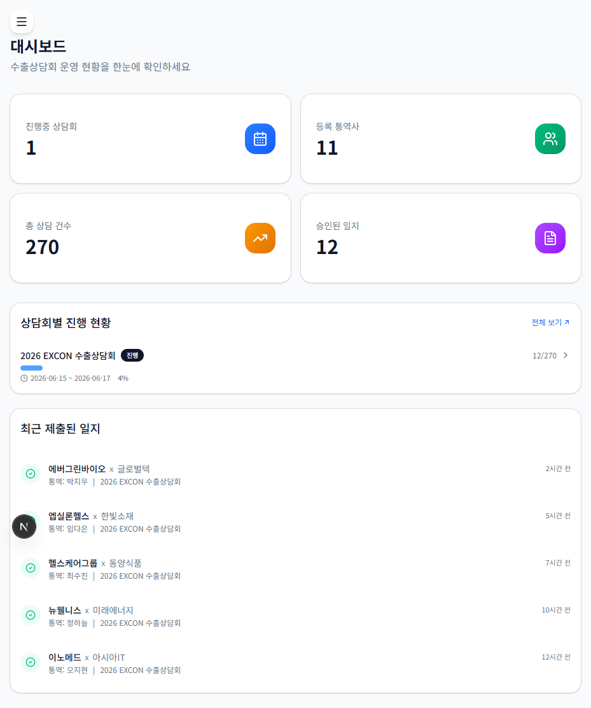

- 좌측 사이드바: 대시보드 / 상담회 관리 / 사용자 관리
- 현재 진행 중인 상담회는 **분석 / 준비 / 운영 / 기록** 4개 카테고리로 그룹화되어 빠르게 진입 가능
- 상단 브레드크럼으로 현재 위치 확인

### 2.2 상담회 관리

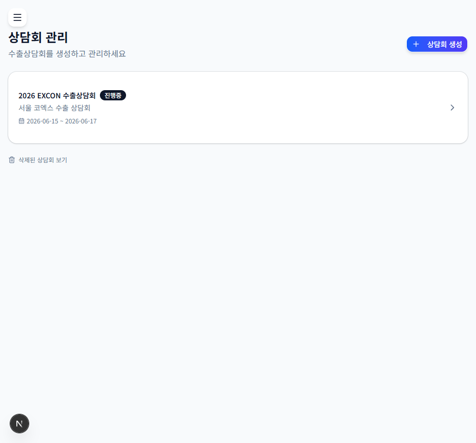

- 등록된 상담회 목록을 카드 형태로 표시
- 진행 상태(Active/Ended), 일정, 설명 한 눈에 확인
- 카드 클릭 시 해당 상담회 상세 화면 진입

**상담회 삭제 (2단계 안전)**
1. 상담회 상세 페이지 우측 상단 **삭제** 버튼 → 소프트 삭제 (`deleted_at` 표시, 복구 가능)
2. 목록 페이지 하단 "삭제된 상담회 보기" → 삭제된 카드에서
   - **복구**: 즉시 활성으로 복원
   - **완전 삭제**: 데이터베이스에서 영구 제거 (되돌릴 수 없음)
     - 확인용 상담회 이름 정확히 타이핑 필요
     - 바이어/셀러/통역사 배정/상담일지/출석/공지 모두 CASCADE 삭제
     - 메시지 로그는 익명화되어 감사용으로 잔존

### 2.3 데이터 업로드 (참가자 등록)

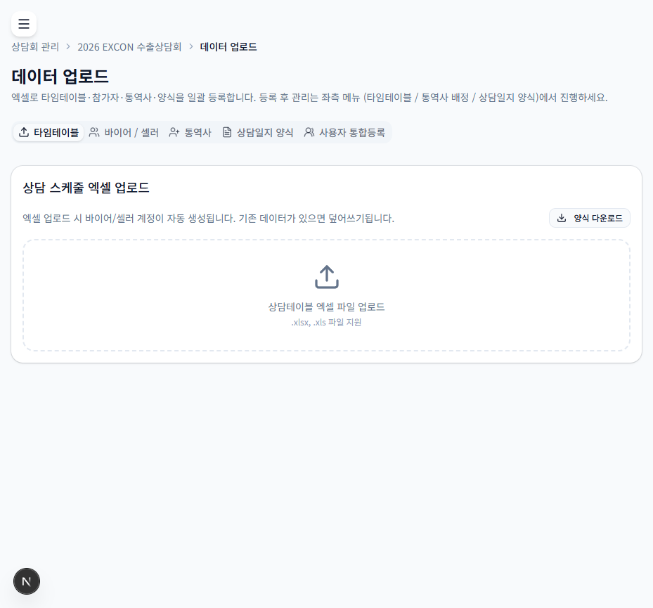

- 바이어 / 셀러 / 통역사 명단 엑셀 일괄 업로드
- 양식 다운로드 → 입력 → 업로드 흐름
- 업로드 후 즉시 미리보기 + 유효성 검사

### 2.4 타임테이블

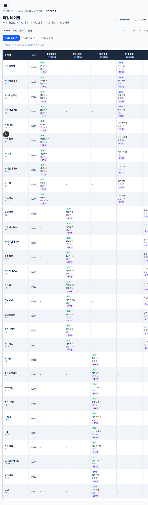

- 일자별·시간대별 상담 스케줄 일괄 업로드
- 바이어↔셀러 매칭 자동 인식
- 변경 시 통역사 사이트 자동 반영

### 2.5 통역사 배정

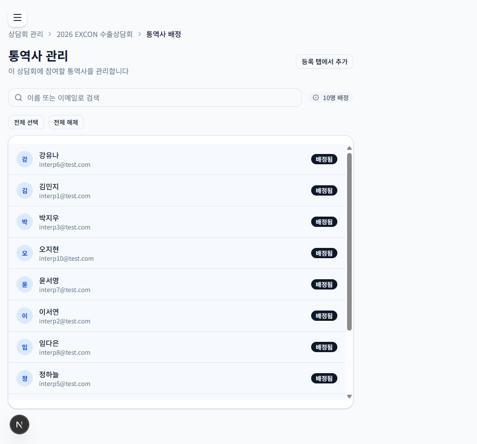

- 등록된 통역사를 상담회에 배정
- 언어별 필터링
- 배정 후 통역사 사이트에서 본인 일정 즉시 확인 가능

### 2.6 상담일지 양식 — 조회

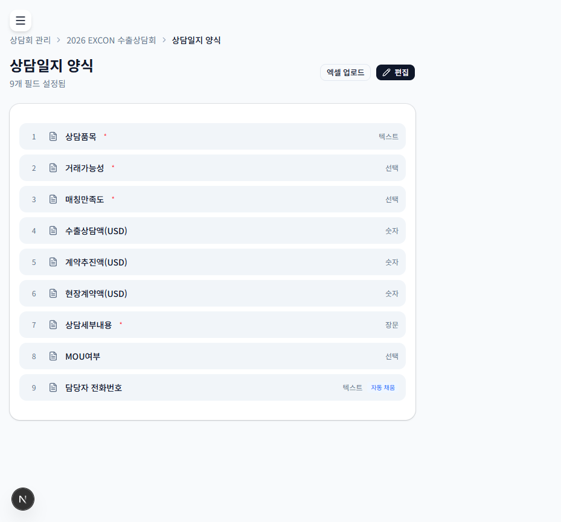

- 등록된 필드 목록을 한 줄씩 표시
- 필드명 / 타입(텍스트·숫자·장문·선택·날짜) / 작성 주체(통역사/자동/관리자) / 조건부 여부 한 눈에 확인

### 2.7 상담일지 양식 — 편집

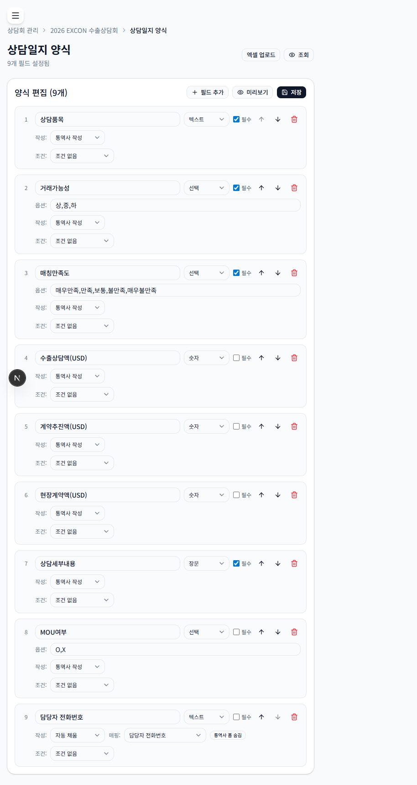

각 필드에 대해 다음 항목을 설정합니다.

- **라벨**: 통역사 화면에 보여질 항목 이름
- **타입**: 텍스트 / 숫자 / 장문 / 선택 / 날짜
- **필수**: 체크 시 미입력 제출 불가
- **작성**: 
  - **통역사 작성** — 통역사가 폼에서 직접 입력
  - **자동 채움** — 상담 일정(상담일·바이어 회사명 등)에서 자동 입력. 통역사 폼에서 숨김
  - **관리자 작성** — 관리자만 입력. 통역사 폼에서 숨김
- **매핑** (자동 채움 선택 시): 자동 채워질 소스(상담일/바이어 회사명/바이어명/국내기업명/국내기업 담당자명/담당자 전화번호 등)
- **조건**: 다른 필드의 답에 따라 노출/숨김

라벨에 "상담일", "바이어 회사명" 등 표준 명칭을 입력하면 작성 주체와 매핑이 **자동으로 추론**되어 설정됩니다.

### 2.8 양식 미리보기

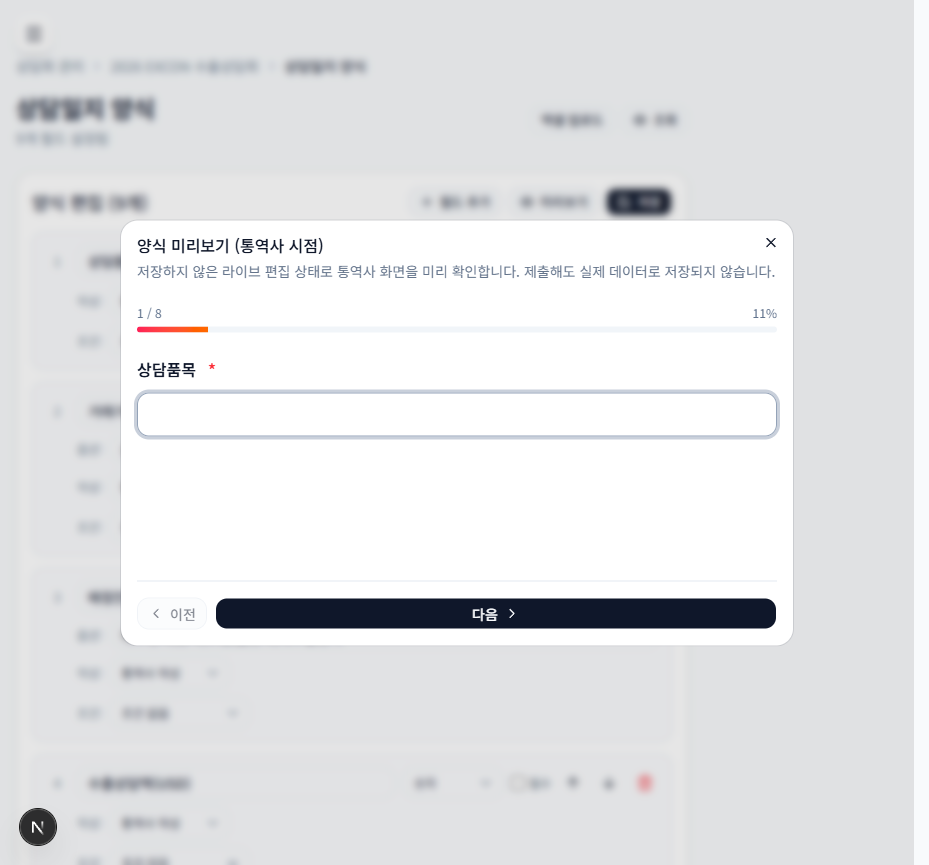

- 편집 중인 양식을 통역사 화면 시점으로 즉시 검증
- 멀티스텝 진행·조건 분기·검토 단계 모두 그대로 동작
- 제출해도 실제 데이터로 저장되지 않음

### 2.9 출석표

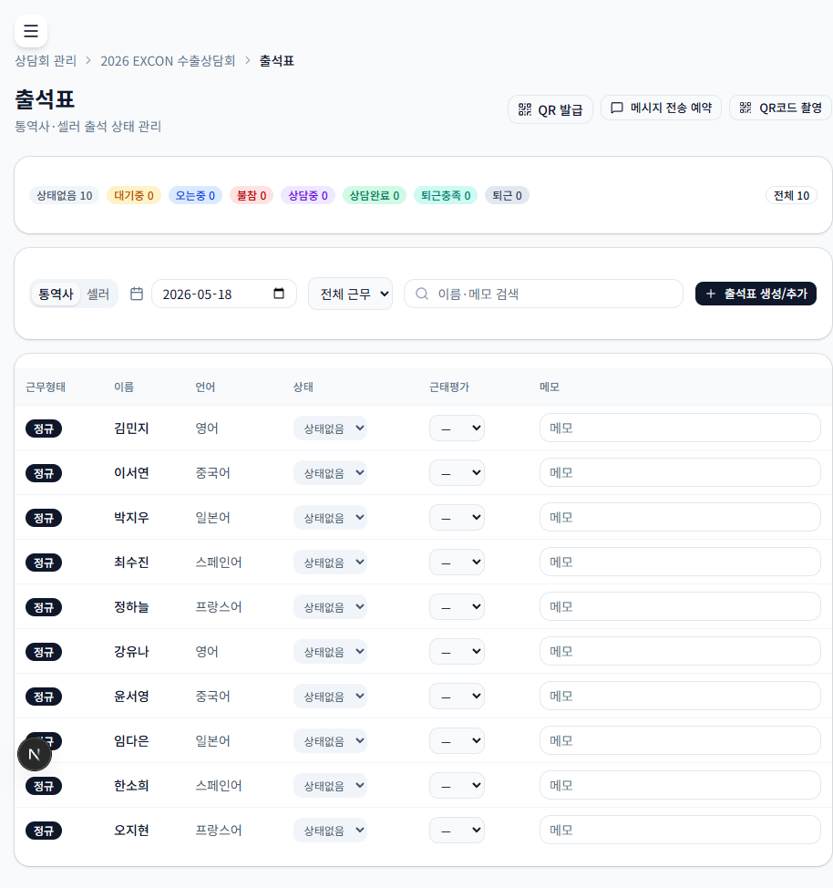

- 통역사 QR 출석 결과를 실시간 확인
- 일자별·시간대별 출결 현황
- 우측 상단 **메시지 전송 예약** 버튼으로 §2.9.1 다이얼로그 호출

#### 2.9.1 메시지 전송 예약

대상 통역사에게 지정 시각 또는 즉시 공지를 발송하는 기능. 출석표 화면의 현재 필터 결과를
대상자로 사용한다.

**작성 탭**
- 본문 텍스트 (1~4000자)
- "지금 발송" 토글 (체크 시 datetime 입력 비활성, 약 1분 내 발송)
- 발송 시각 (datetime-local, 현재 시각 이후만)
- 대상자 카운트는 현재 필터 결과 기준
- "예약" 클릭 → 1분 단위 cron 이 정확한 시각에 자동 발송

**예약 목록 탭**
- 발송 시각이 이른 순으로 정렬
- 상태 배지:
  - 대기 (scheduled) — 수정/취소 가능
  - 발송됨 (sent) — 읽기 전용
  - 취소됨 (cancelled) — 읽기 전용
  - 실패 (failed) — "실패 사유" 버튼으로 원인 확인
- 30초마다 자동 새로고침 (백그라운드 탭에서는 일시 중지)
- 수정 클릭 → 작성 탭으로 자동 전환 + 본문/시각 prefill
- 취소 클릭 → confirm 후 즉시 cancelled 전이 (발송 안 됨)

**운영자 주의 사항 (FAQ)**

| 증상 | 원인 | 처리 |
|---|---|---|
| "과거 시각으로 예약할 수 없습니다" | datetime 이 현재보다 이전 | 미래 시각 입력 |
| "행사 종료일 이후로는 예약할 수 없습니다" | 행사 end_date 초과 | 행사 기간 내 시각으로 |
| "메시지를 입력하세요" | 빈 본문 또는 공백만 | 본문 입력 |
| "대상자가 1명 이상이어야 합니다" | 필터 결과 0명 | 필터 해제 또는 통역사 추가 |
| "이미 발송되었거나 취소된 예약입니다" | cron 이 먼저 발송 / 다른 admin 이 취소 | 목록 새로고침 후 상태 확인 |
| 수정 시 대상자가 변하지 않음 | 의도된 동작 — 수정은 본문/시각만 변경 | 대상자 변경하려면 신규 예약 후 기존 취소 |

### 2.10 현장운영

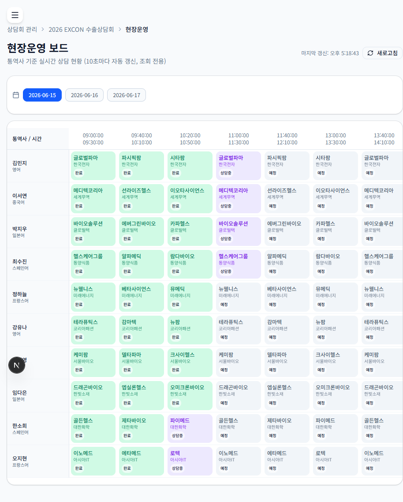

- 진행 중인 상담의 상태 모니터링
- 바이어 도착·진행 중·완료 상태 한 화면에서 추적

### 2.11 인포데스크 (키오스크 모드)

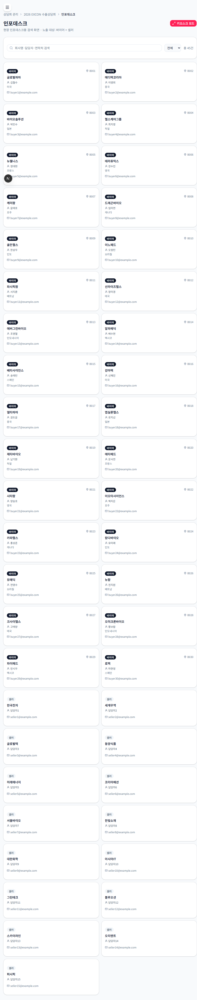

- 행사장 안내 데스크용 키오스크 화면
- 바이어가 본인 일정 / 부스 위치 확인
- 큰 폰트, 단순 입력으로 비전문가 사용 가능

### 2.12 공지사항

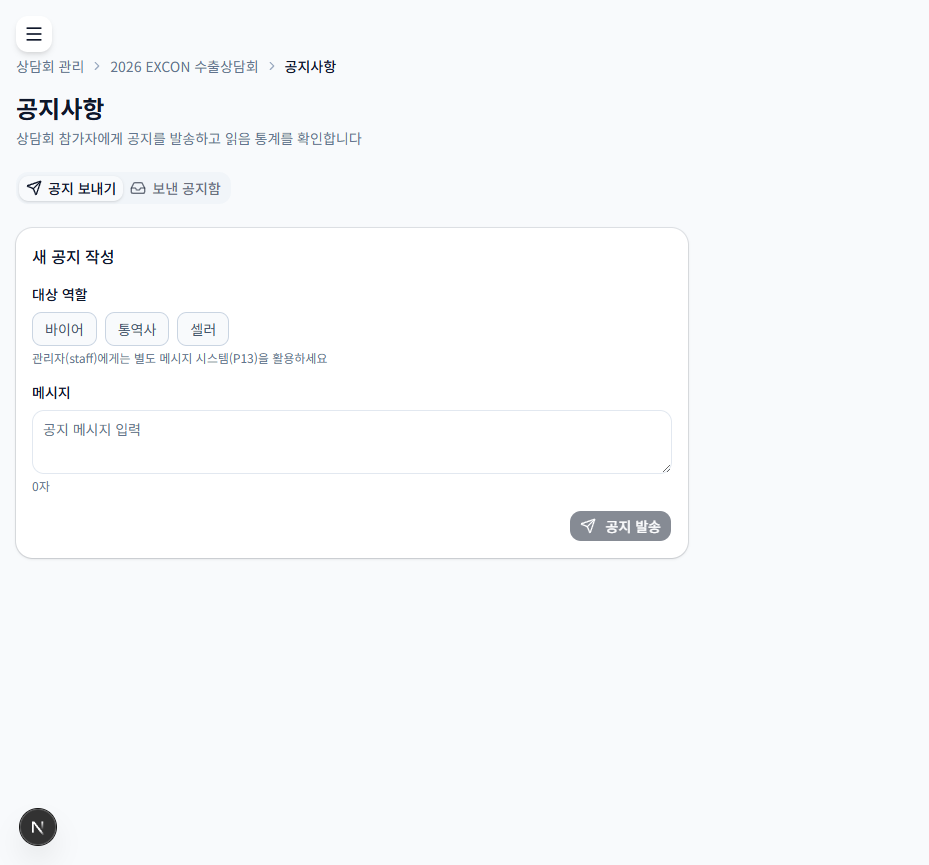

- 상담회 참여자(관리자/통역사/셀러/바이어)에게 공지 발송
- 대상 역할 선택 가능
- 통역사 사이트에 즉시 노출 + 읽음 처리 트래킹

### 2.13 상담회 분석 대시보드

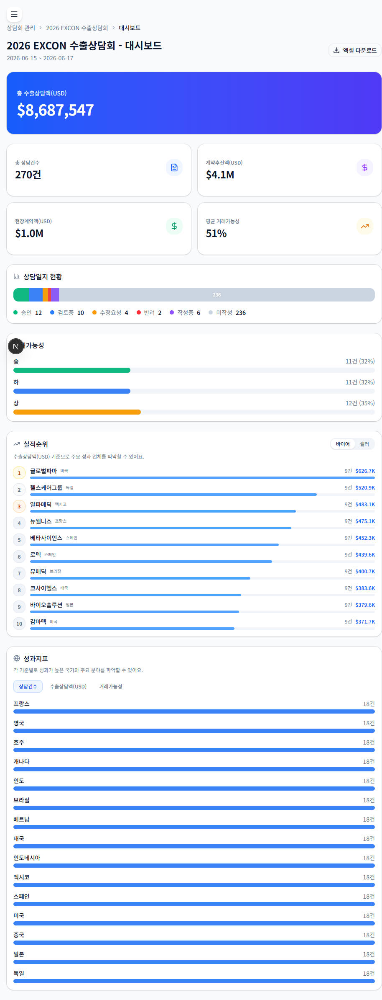

- 진행률·승인률·우수상담·반려 현황 KPI 카드
- 일자별·통역사별 분포 시각화
- 진행 중에도 실시간 갱신

### 2.14 상담일지 조회 (리스트)

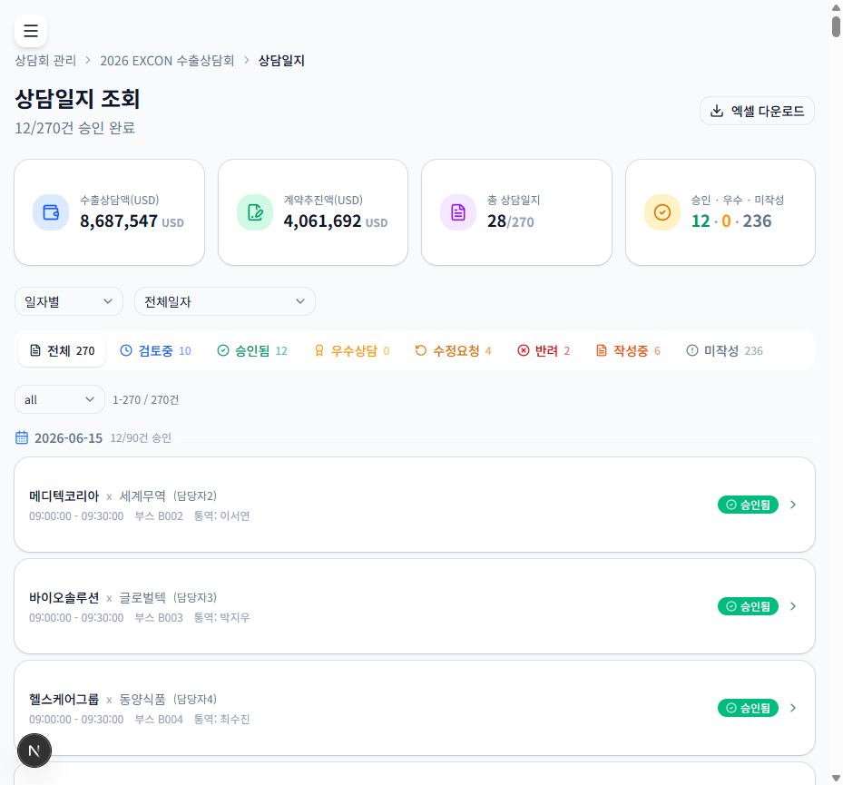

- KPI 4종: 수출상담액 / 계약추진액 / 총 상담일지 / 승인·우수·미작성
- 상태별 필터 탭 (전체/검토중/승인됨/우수상담/수정요청/반려/작성중/미작성)
- 그룹화: 일자별 / 부스별 / 시간별 / 바이어별 / 셀러별 / 통역사별
- 각 카드: 바이어 × 셀러 (담당자명) + 시간 / 부스 / 통역사 / 상태 배지
- **데이터 확인 필요** 뱃지: 통역사가 자동 채움 정보 누락을 보고한 항목 표시
- 엑셀 다운로드

### 2.15 상담일지 상세

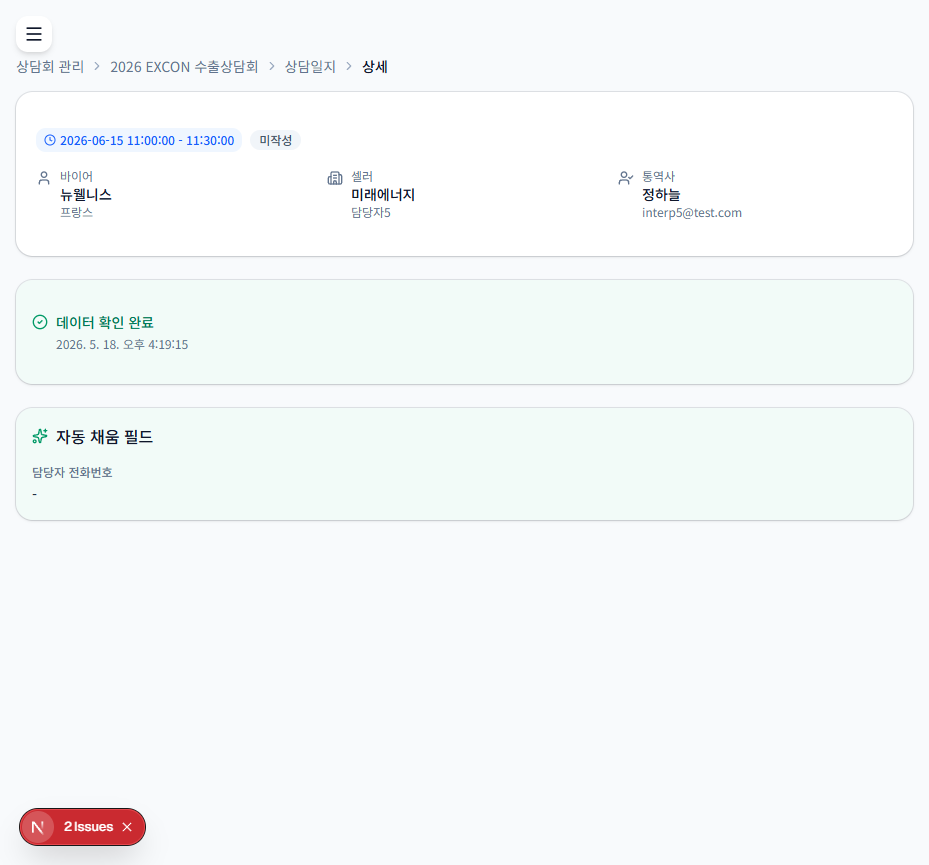

다음 카드들로 구성됩니다.

- 상담 헤더 (시간·바이어·셀러·통역사·상태)
- **데이터 확인 요청 알림** (있을 때): 통역사가 누락 항목을 신고한 경우 표시 + "확인 완료" 처리 버튼
- 상태 안내 + 승인/수정요청/반려/우수상담 액션
- **자동 채움 필드**: 상담 정보에서 자동으로 채워진 값
- **관리자 입력 필드**: 사업자등록번호·담당자 직위·바이어 ID 등 관리자가 작성하는 항목 (저장 시 즉시 반영)
- 통역사 작성 내용 (제출본)

### 2.16 메신저 (관리자)

상담회 상세 → "메시지" 메뉴.

- 좌측: 이벤트 내 통역사 명단
  - unread 뱃지 (미확인 메시지 건수)
  - 마지막 메시지 시각·미리보기
  - 검색·필터로 빠른 탐색
- 우측: 선택한 통역사와 1:1 채팅창
  - 50건 단위 cursor 페이지네이션 (위로 무한 스크롤)
  - 첨부 (이미지/PDF) 업로드·다운로드, 5MB·MIME 제한
  - 통역사가 보낸 메시지에 자동 읽음 처리 (admin 이 thread 열람 시)
- 다중 관리자 응답 가능 — 같은 thread 에서 모든 관리자 응답이 함께 보임
- admin 은 본인/타인 메시지 모두 soft delete 가능 → "관리자에 의해 삭제된 메시지" placeholder
- 이벤트 종료 후 발송 차단, 조회만 가능 (상단 배너)
- 공지(notice) 발송과 별개 — notice 는 일방 broadcast, 메신저는 1:1 양방향

---

## 3. 통역사 화면

### 3.1 대시보드

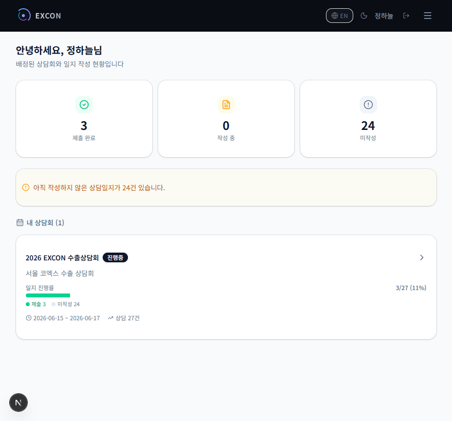

- 본인이 배정된 상담회 목록
- 전체 상담 / 제출 / 작성중 / 미작성 통계
- 상담회 카드 클릭 시 상세 진입

### 3.2 잔여 일지 팝업

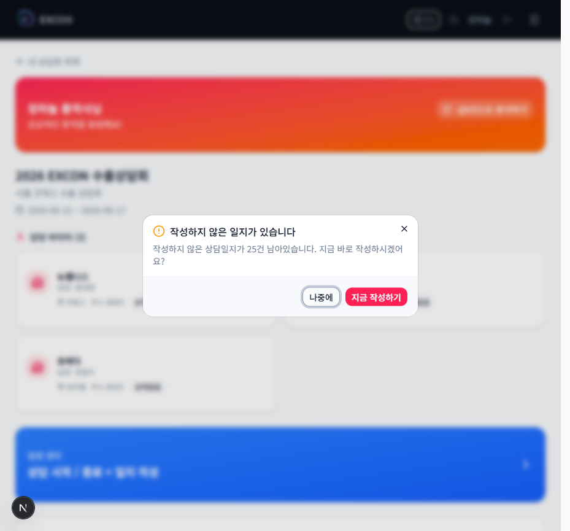

- 상담회 진입 시 처리해야 할 일지가 있으면 자동 표시
- 상태별 건수 chip 으로 한눈에 확인: **미작성 / 작성중 / 수정요청 / 반려** (0건 항목은 숨김)
- "지금 작성하기" 버튼: 첫 번째 잔여 상담일지로 바로 이동
- "나중에" 버튼: 닫기 (다음 진입 시 잔여 > 0 이면 다시 표시)

### 3.3 상담회 이벤트 페이지

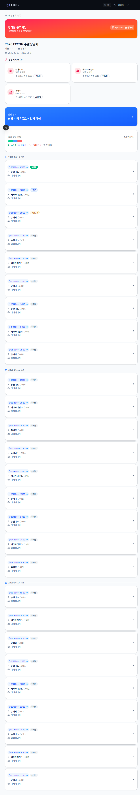

- 인사말 + QR 출석 체크인 버튼
- 담당 바이어 카드 목록 (회사명·담당자·국가·부스·현재 상태)
- 일정 관리 진입
- 진행률 + 상태별 카운트 (승인됨·우수상담·검토중·수정요청·반려·작성중·미작성)
- 날짜별 상담 목록 (시간·바이어·셀러·상태)

### 3.4 일정 관리 (상담 시작/종료 토글)

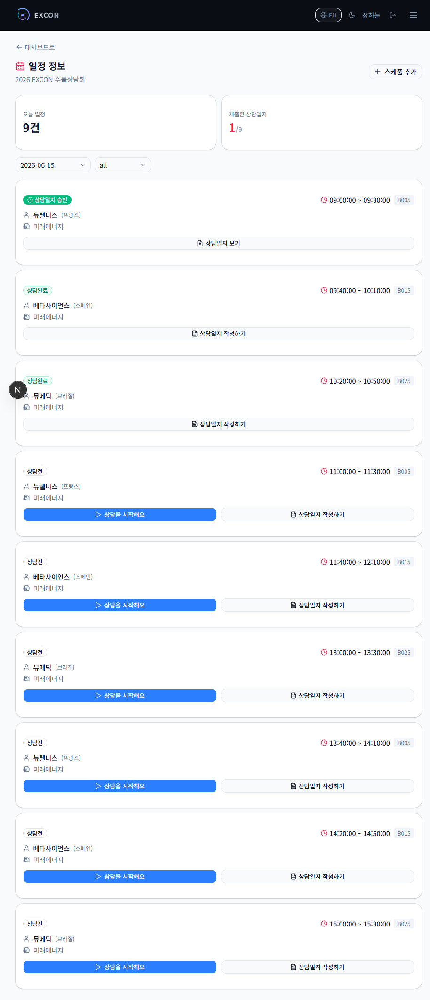

- 각 상담의 시작 / 종료 시각 기록
- 시작 → 종료 후 일지 작성 진입
- 필터(일자별·상태별)로 빠른 탐색

### 3.5 상담일지 작성 (멀티스텝)

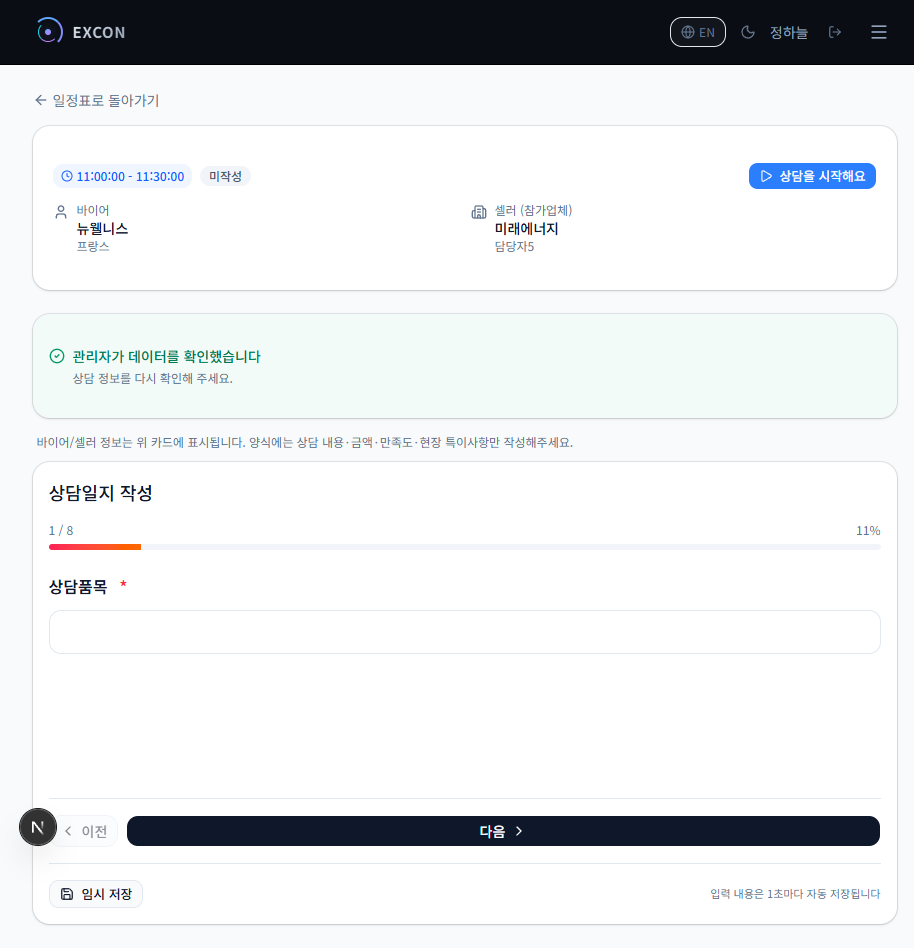

- 상단에 바이어·셀러 정보 카드 (자동 채움)
- 진행 단계 바 + 1초마다 자동 저장
- 한 단계당 1개 필드 → 모바일 친화
- 마지막 단계는 검토(Review) — 전체 답변 확인 후 제출
- 조건 분기 자동 처리 (불참 사유 등)
- 일부 자동 채움 정보가 비어 있으면 상단에 빨간 경고 + "관리자에게 확인 요청" 버튼 노출

**제출 확인 모달**
- "제출 후에도 관리자 검토 결과에 따라 수정 요청을 받을 수 있어요. 반려 혹은 수정요청을 받는다면 사유를 보고 재작성해 주세요." 안내 노출
- 제출 = 일지가 영구히 잠기는 것이 아님 — 관리자 판단에 따라 다시 편집 권한이 열릴 수 있음

**수정요청 / 반려 상태**
- 상담일지 진입 시 상단에 빨간 카드 표시: "관리자 수정요청 사유"
  - 안내문: "관리자 수정요청 사항을 확인하여 상담일지를 수정해 주세요."
  - 관리자 코멘트가 있으면 구분선 아래에 함께 표시
- 폼이 다시 편집 가능 상태로 전환되며, 제출 버튼은 "재제출"로 라벨 변경

### 3.6 공지사항

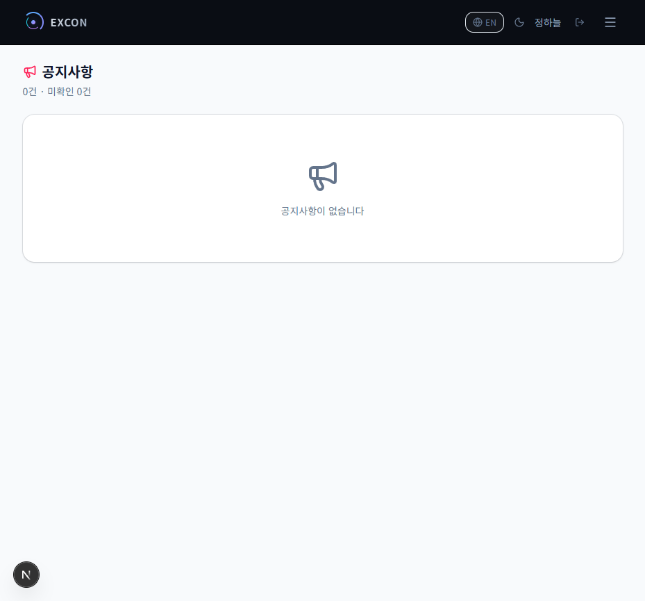

- 관리자가 발송한 공지 확인
- 미확인 / 확인 토글
- 게시일 + 발송 대상 표시
- 관리자가 수정한 공지는 본문 아래 "(수정됨 …)" 라벨 노출
- 관리자가 삭제한 공지는 즉시 목록에서 사라짐
- 관리자가 §2.9.1 "메시지 전송 예약" 으로 특정 통역사들에게만 보낸 공지는
  대상자 본인에게만 보이고, 대상이 아닌 통역사 화면에는 노출되지 않는다
  (사이드메뉴 미확인 카운트도 본인 카운트만 증가)

### 3.7 메신저 (관리자 ↔ 통역사 양방향)

- 사이드메뉴 "메시지" 진입 → "관리자에게 보내기" 단일 채널
- 텍스트 + 이미지(JPG/PNG/WEBP)·PDF 첨부 (메시지당 3개, 파일당 5MB)
- Supabase Realtime 으로 실시간 수신
- 본인 메시지 옆 ✓(전송됨) / ✓✓(읽음) 표시
- 사이드메뉴·탭 제목 (N) 으로 미확인 카운트
- 본인 메시지는 우측 ⋯ 삭제 → "삭제된 메시지" placeholder
- 이벤트 종료 후엔 상단 amber 배너 + 입력창 비활성 (조회는 가능)
- RLS 로 다른 통역사 thread 접근 불가 (URL 직접 입력 시 차단)

---

## 4. 자주 묻는 질문

**Q. 자동 채움 항목이 비어 있어요.**
A. 통역사 페이지의 빨간 경고 카드에서 "관리자에게 확인 요청" 버튼을 누르세요. 관리자 상담일지 화면에 알림이 표시되어 마스터 데이터 보정 후 "확인 완료" 처리됩니다.

**Q. 우수상담은 어떻게 지정되나요?**
A. 통역사가 일지 제출 후 관리자가 상담일지 상세에서 승인 → "우수상담으로 지정" 버튼으로 마킹합니다.

**Q. 양식 필드를 추가/수정하려면?**
A. 관리자 → 상담일지 양식 → 편집. 필드 추가 후 라벨을 입력하면 작성 주체·자동 매핑이 자동 추론됩니다. 미리보기로 통역사 시점 검증 후 저장.

**Q. 언어를 바꾸려면?**
A. 우측 상단의 언어 토글(한국어 / English) 클릭. 새로고침해도 유지됩니다.

---

## 5. 매뉴얼 유지보수

본 매뉴얼은 EXCON 운영 시스템의 사용자 가이드입니다. 화면 구성·기능 변경 시 다음 순서로 갱신합니다.

1. 변경된 화면 캡처 (`manual-screenshots/` 폴더에 동일 파일명으로 덮어쓰기 또는 신규 추가)
2. 본 `MANUAL.md`의 해당 섹션 텍스트 보강
3. 마지막 갱신 일자 (문서 최상단) 업데이트
4. commit/push 시 매뉴얼 변경분 함께 포함

신규 화면 추가 시: 새 섹션 + 스크린샷 + 사용 절차 함께 작성.
